# Hybrid Homelab Infrastructure & Network Security Lab

A multi-node, fault-tolerant **Hybrid Homelab Environment** designed to simulate enterprise infrastructure, network segmentation, high-availability DNS, reverse proxy routing, and proactive health monitoring.

---

## Architecture & Topology

The infrastructure is split into distinct physical and virtual tiers to avoid single points of failure (SPOF) and implement defense-in-depth principles:

1. **Hypervisor Node (x86_64):** Bare-metal Proxmox VE running on a dedicated laptop host with native battery backup (integrated hardware UPS:).
2. **Management & Edge Node (ARM64):** Dedicated Raspberry Pi 3 Model B running Docker.
3. **Security & Routing Lab:** Virtualized OPNsense firewall appliance connected to dedicated Linux clients via internal virtual networking.
4. **Client & Administration Workstation:** CachyOS (Arch Linux) utilizing native terminal utilities and SSH for remote administration.

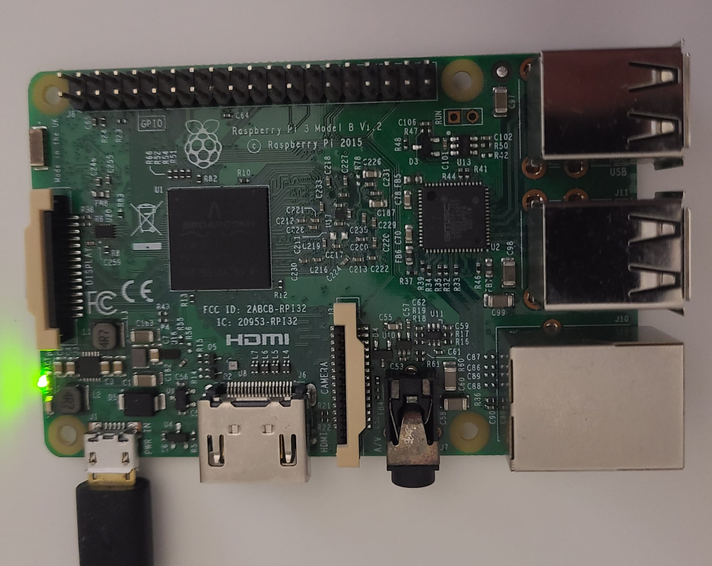

---

## Containerized Microservices & Management

The ARM64 management node runs containerized workloads managed via Portainer. This node hosts critical baseline services that must remain accessible even during hypervisor maintenance windows:

- **Nextcloud:** Private self-hosted cloud storage
- **WireGuard (`wg-easy`):** Encrypted L3 VPN endpoint for secure remote access
- **Uptime Kuma:** Central monitoring instance
- **Pi-hole (Secondary):** Backup DNS resolver

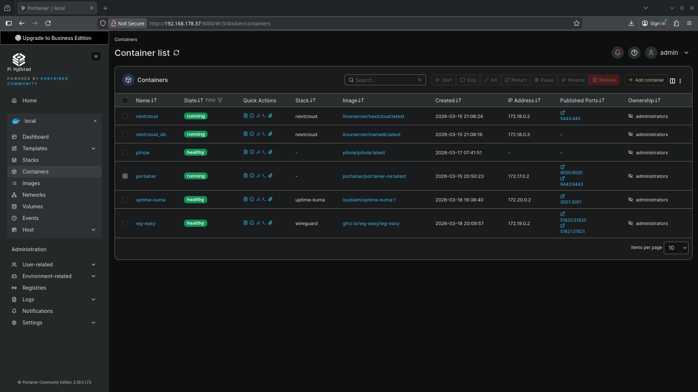

---

## ⚙️ Hypervisor Operations & Troubleshooting Case Study

### Port Conflict Resolution (Port 80 Ingress)
During the initial deployment of Nginx Proxy Manager on the primary node, a binding conflict occurred (`0.0.0.0:80/tcp: address already in use`). 
- **Root Cause:** The primary Pi-hole instance's embedded Lighttpd web server was already binding to privileged port 80.
- **Remediation:** Rather than remapping ports arbitrarily, architectural separation of concerns was enforced by migrating Nginx Proxy Manager into its own dedicated, unprivileged LXC container with nested virtualization enabled (`nesting=1`).

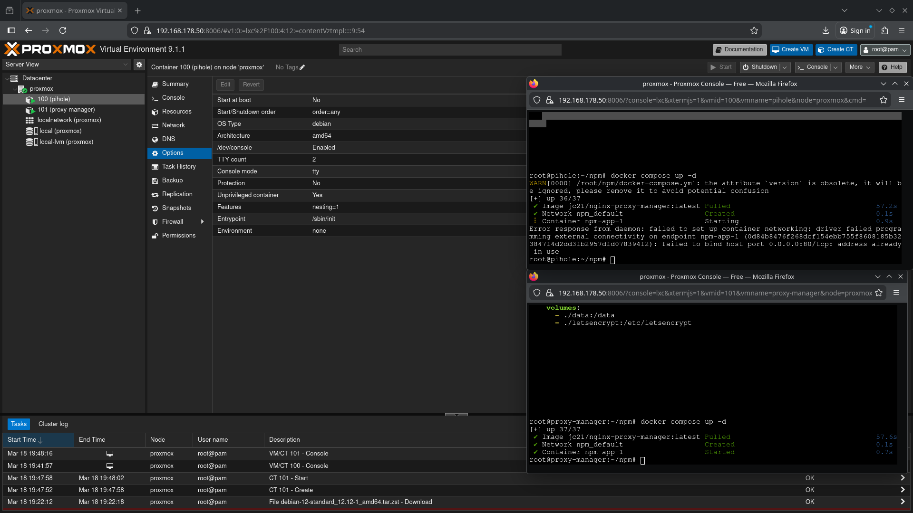

---

## High-Availability DNS Architecture

DNS is configured redundantly across both physical architectures to guarantee uninterrupted name resolution across the local subnet:

1. **Primary DNS Resolver:** Containerized Pi-hole running on the Proxmox Hypervisor (`192.168.178.51`).
2. **Secondary DNS Resolver:** Containerized Pi-hole running on the physical Raspberry Pi (`192.168.178.37`).

Both resolvers operate active blocklists (over 80,000 domains) and sinkhole tracking and telemetry queries in real time.

| Primary Node (Proxmox VE - .51) | Secondary Node (Raspberry Pi - .37) |
| :---: | :---: |
| 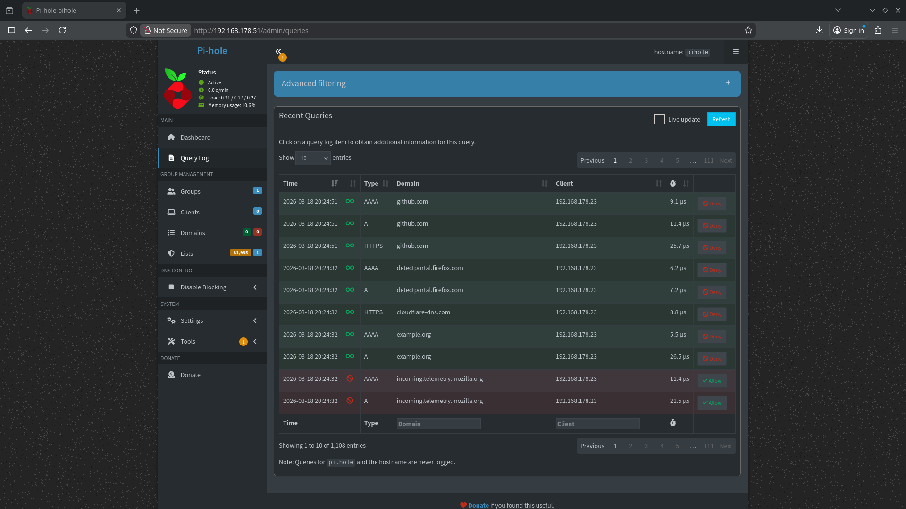 | 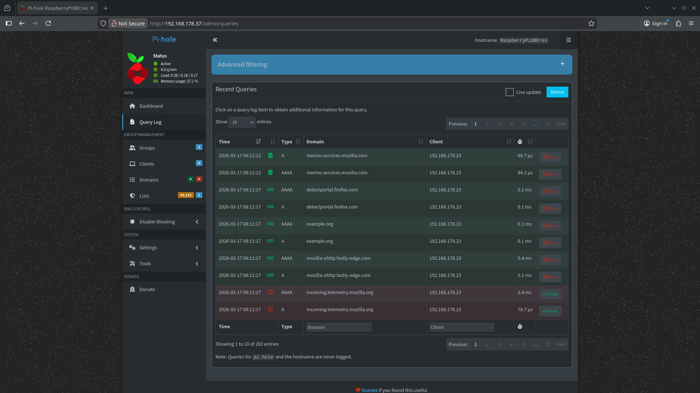 |

---

## 🌐 Ingress Routing & Reverse Proxying

Centralized HTTP/HTTPS traffic ingress is handled by **Nginx Proxy Manager** (`192.168.178.52`). It eliminates port proliferation by routing human-readable local domains to internal container endpoints:

- `nginx.home` $\rightarrow$ Nginx Proxy Manager Admin (`192.168.178.52:81`)
- `pihole.home` $\rightarrow$ Primary Pi-hole Dashboard (`192.168.178.51:80`)
- `uptime.home` $\rightarrow$ Monitoring Dashboard (`192.168.178.37:3001`)
- `wireguard.home` $\rightarrow$ WireGuard Management (`192.168.178.37:51821`)

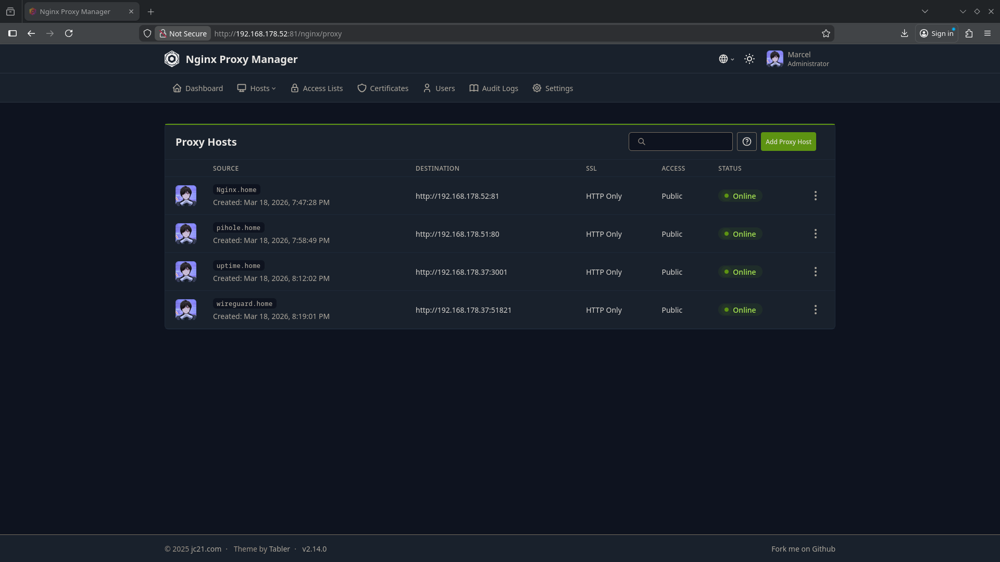

---

## 📊 Service Health Monitoring

System availability is monitored continuously via an isolated **Uptime Kuma** instance. The engine executes ICMP ping sweeps and HTTP status checks every 60 seconds:

- **Monitored Targets:** Core Gateway/Router, Nginx Proxy Manager, Pi-hole DNS, Proxmox Hypervisor Host.
- **Failover Verification:** The independent placement on the Raspberry Pi ensures alerts trigger even during hypervisor outages.

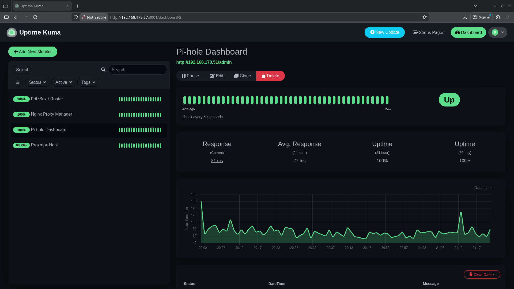

---

## 🔐 Encrypted Ingress: WireGuard VPN

External access into the internal homelab subnet is secured via a hardened **WireGuard** endpoint:
- Cryptographically isolated tunnel avoiding public port exposure of internal management dashboards.
- Configuration managed and provisioned via `wg-easy` with hashed authentication credentials.

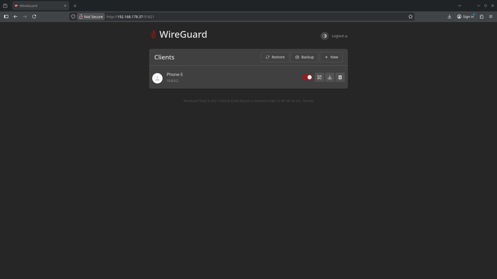

---

## 🛡️ Network Segmentation Lab: OPNsense & Routing

To analyze Layer 3 routing, packet filtering, and NAT mechanisms outside production traffic, an isolated security lab was configured in Oracle VirtualBox:
- **WAN Interface (`em1`):** Bridged/NAT uplink (`10.0.3.15/24`).
- **LAN Interface (`em0`):** Isolated internal network (`192.168.1.1/24`) serving dynamic DHCP leases to attached Linux client workstations.

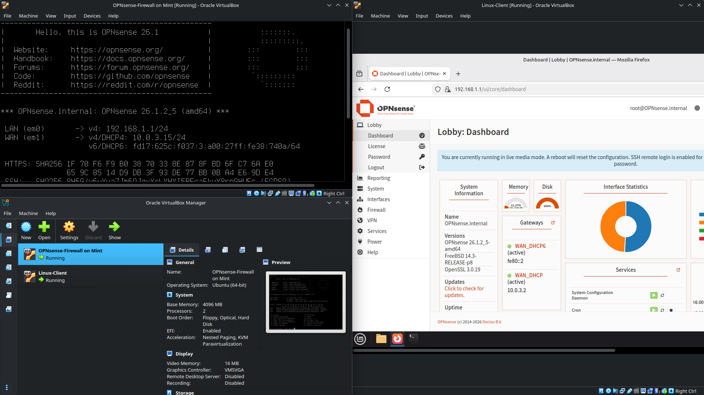

---

## Windows Server Integration

To maintain full multi-platform competency alongside Linux, a dedicated **Windows Server 2022 Standard** instance was deployed as a virtual machine on Proxmox VE (VM ID 102).
- Provisioned with VirtIO drivers and QEMU guest agent integration.

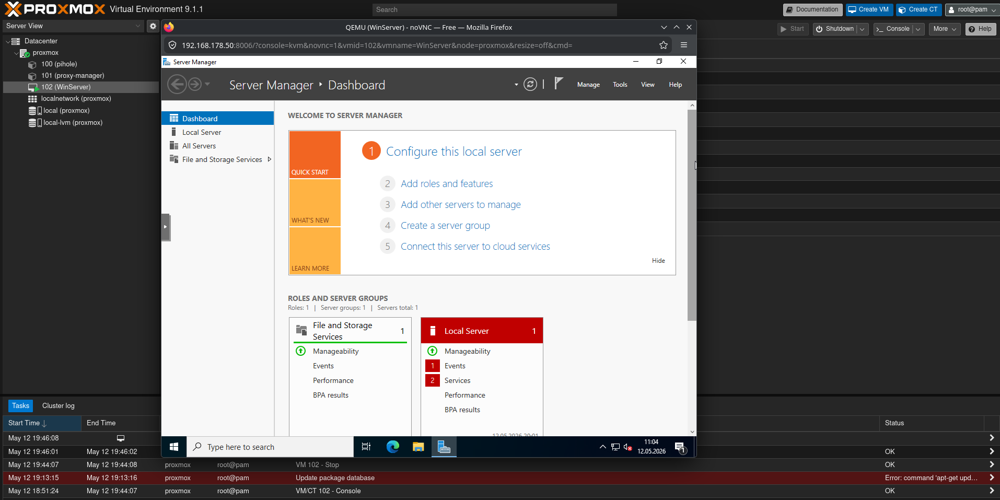

---

## 🖥️ Workstation & Administration Environment

Administrative tasks, shell scripting, and remote management sessions are performed from a customized **CachyOS (Arch Linux)** workstation via secure OpenSSH sessions to edge devices.

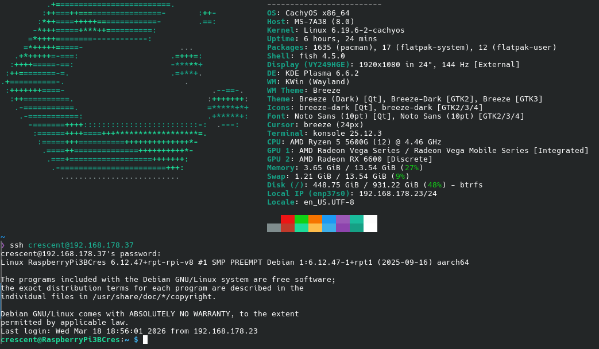
